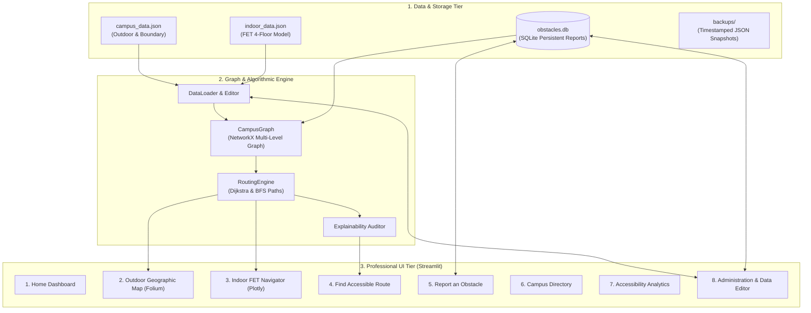

<<<<<<< HEAD
# Accessible Campus Navigator

A desktop application that helps students find **accessible routes** between locations on a fictional college campus.

> **Note:** The campus used in this application is entirely fictional and created for demonstration purposes only.

## Features

- **Standard & Accessible Routing** — find shortest paths that respect wheelchair, ramp, elevator, and stair-avoidance requirements.
- **BFS & Dijkstra Algorithms** — demonstrates both unweighted (BFS) and weighted (Dijkstra) shortest-path algorithms.
- **Visual Campus Map** — interactive Tkinter canvas showing locations, edges, and highlighted routes.
- **Obstacle Reporting** — report and view active accessibility issues (e.g., broken ramp, elevator out of service).
- **Statistics Dashboard** — route distance, estimated travel time, and accessibility information at a glance.
- **Fully Offline** — no internet connection, external APIs, or third-party packages required.

## Technology Stack

| Component | Technology |
|-----------|-----------|
| Language | Python 3 |
| GUI | Tkinter + ttk |
| Data Format | JSON |
| Algorithms | BFS (collections.deque), Dijkstra (heapq) |
| Testing | unittest |

## Project Structure

```
AccessibleCampusNavigator/
│
├── main.py                    # Application entry point
├── campus_data.json           # Fictional campus graph data
├── obstacles.json             # Reported accessibility obstacles
├── README.md
├── requirements.txt
│
├── core/                      # Graph & algorithm logic
│   ├── graph.py               # Campus graph data structure
│   ├── algorithms.py          # BFS and Dijkstra implementations
│   └── accessibility.py       # Accessibility mode filters
│
├── services/                  # Data and file handling
│   ├── data_manager.py        # Load/save campus data
│   └── obstacle_manager.py    # Load/save obstacle reports
│
├── gui/                       # Tkinter user interface
│   ├── main_window.py         # Main window and dashboard
│   ├── map_view.py            # Canvas-based campus map
│   └── dialogs.py             # Help and About dialogs
│
└── tests/                     # Unit test suite
    ├── test_graph.py
    ├── test_algorithms.py
    └── test_accessibility.py
```

## How to Run

```bash
# Run the application
python main.py

# Run all unit tests
python -m unittest discover -s tests
```

## Requirements

**No third-party packages required.** This project uses only the Python standard library.

See `requirements.txt` for the full list of standard library modules used.

## Accessibility Modes

| Mode | Behaviour |
|------|-----------|
| Standard | Normal shortest path, no filtering |
| Wheelchair Accessible | Avoids stairs, prefers ramps and elevators |
| Avoid Stairs | Excludes all stair edges |
| Prefer Ramps | Lowers cost of ramp-equipped edges |
| Require Elevator | Only uses paths with elevator access between floors |

## Academic Context

This project was developed as a mini project for academic evaluation, demonstrating:

1. Python programming
2. Graph data structures
3. BFS algorithm
4. Dijkstra's shortest-path algorithm
5. JSON file handling
6. Tkinter GUI development
7. File handling and exception handling
8. Basic software architecture
9. Unit testing

## License

Academic project — for educational purposes only.
=======
# ACCESSIBLE CAMPUS NAVIGATOR ♿🏛️
### Smart Indoor & Outdoor Accessibility Navigation System
**Tagline:** *"Every Destination Accessible. Every Student Included."*

Designed for:
**JAIN (Deemed-to-be University)**  
Faculty of Engineering and Technology (FET)  
JAIN Global Campus, Jakkasandra Post, Kanakapura Road, Ramanagara District, Karnataka, India (`12.6482° N, 77.4418° E`).

---

## 📌 1. Project Overview & Context

Navigating large, multi-level university campuses poses severe challenges for wheelchair users, students with limited mobility, visually impaired individuals, and visitors. Main entrances frequently feature steps, elevators encounter sudden maintenance outages, and corridor ramps can become temporarily blocked.

**Accessible Campus Navigator** is an accessibility-first geospatial and indoor graph-routing application built with Python, NetworkX, Folium, Plotly, SQLite, and Streamlit. It bridges the gap between outdoor terrain navigation and multi-floor indoor routing, providing audited, constraint-aware pathfinding.

### 🏛️ Geographic Integrity & Three-Tier Data Distinction
To maintain scientific and ethical integrity, the system strictly separates three levels of campus information:
1. **Real Geographic Data (`VERIFIED`)**: Official campus perimeter boundaries, GPS coordinates (`12.6482° N, 77.4418° E`), access gates on NH-209 / Kanakapura Road, and arterial avenues referenced directly from official university publications ([FET Contacts](https://set.jainuniversity.ac.in/contacts), [JAIN Location Maps](https://www.jainuniversity.ac.in/contact/top-indian-university-with-best-colleges-with-location-maps)) and OpenStreetMap.
2. **Provisional Campus Data (`PROVISIONAL`)**: Unsurveyed destinations or pathway segments awaiting on-site physical measurement (e.g. precise door widths, tactile guidance tags, surface friction). Unlocated destinations remain without artificial GPS coordinates (retaining `null` latitude/longitude) to prevent false positioning.
3. **Demonstration Floor Plans (`DEMONSTRATION`)**: An illustrative four-floor architectural model for the FET Engineering Complex (Ground, 1F, 2F, 3F). Prominently labeled with:
   > **"DEMONSTRATION FLOOR PLAN — NOT AN OFFICIAL FET FLOOR PLAN"**  
   Designed to be replaced with verified architectural CAD/SVG blueprints when officially authorized.

---

## 🎯 2. Objectives & Core Capabilities

- **Constraint-Enforced Routing**: Guarantees step-free, stair-prohibited pathways for wheelchair users, while prioritizing elevators and ramps.
- **Explainable Auditing**: Explains *why* a route was recommended and discloses all data uncertainties (unmeasured door widths, unknown surface materials).
- **Dynamic Obstacle Engine**: Tracks physical barriers and elevator breakdowns via persistent SQLite storage. Severe reports immediately trigger graph edge exclusions and route recalculation.
- **Multi-Level Navigation**: Unified graph transitions from outdoor campus pathways into ground-floor lobbies, continuing across floors via elevators or stairwells.
- **Data-Management Studio**: Administrator portal to add/edit locations and pathways, adjust coordinates, validate datasets, create backups, and import/export JSON without editing Python code.
- **Fail-Safe Operation**: Resilient fallback handling if external map tile servers are unreachable, allowing offline directory browsing and step-by-step guidance.

---

## 🏗️ 3. Architecture & Technical Stack



### Technology Stack
- **Language**: Python 3.10+ (Tested on Python 3.14).
- **Graph Algorithms**: `networkx` (Multi-level directed & unweighted graphs, Dijkstra, BFS).
- **Web Frontend**: `streamlit` (8-page responsive application with accessible dark navy sidebar and light neutral workspace).
- **Geographic Mapping**: `folium`, `streamlit-folium` (OpenStreetMap tile provider).
- **Indoor Floor Visualization**: `plotly` (2D schematic interactive layout with clickable room focus and route highlights).
- **Data Persistence**: `sqlite3` (parameterized queries, transaction context managers, ISO timestamps).
- **Testing**: `pytest` (63 passing automated unit and integration tests).

---

## 🧮 4. Graph Algorithm Insights

### A. BFS vs. Dijkstra (Why BFS is Not Always Shortest or Accessible)
- **Breadth-First Search (BFS)** finds the path that minimizes the **number of graph edges (hops)**. It treats every edge as having equal weight ($1$).
- **Dijkstra's Algorithm** finds the path that minimizes the **cumulative weighted cost** (physical distance in meters or travel time in seconds).
- **Educational Contrast**:
  - A direct outdoor path might consist of $2$ hops covering $300\text{ m}$.
  - An alternative route through paved building corridors might take $4$ hops covering only $180\text{ m}$.
  - BFS will select the $2$-hop path ($300\text{ m}$) because it has fewer edges, whereas Dijkstra will correctly select the $4$-hop path ($180\text{ m}$) because it minimizes physical distance.
  - Furthermore, BFS does not naturally balance physical accessibility constraints (slopes, door widths, surface friction) without edge pruning.

### B. Why the Shortest Route is Not Always the Most Accessible
- The geometrically shortest route between an entrance and a 2nd-floor classroom typically cuts straight through an exterior staircase ($40\text{ m}$).
- For a wheelchair user or student with limited mobility, this staircase is an **impassable physical barrier**.
- An accessible route requires following an exterior ramp to a level entrance, navigating to the elevator lobby, ascending to the 2nd floor, and following a wide corridor ($140\text{ m}$).
- **Accessibility routing must optimize for barrier-free eligibility before metric distance.**

### C. How Obstacles Dynamically Affect the Graph
- When an obstacle is verified (e.g. an elevator is down for maintenance or a ramp is blocked), the active graph temporarily **removes the corresponding edge** or assigns it an infinite traversal weight ($\infty$).
- If alternative step-free paths exist (e.g. a secondary ramp or alternative wing elevator), Dijkstra automatically routes around the obstruction.
- If no eligible accessible path remains (e.g. the sole elevator to an upper floor is blocked), the system **fails safely and explicitly**, detailing the exact constraint violations rather than silently rerouting a wheelchair user onto stairs.

---

## 🚀 5. Installation and Running

### Prerequisites
- Python 3.10 to 3.14 installed.
- Git.

### 1. Clone & Set Up Virtual Environment
```powershell
git clone <repository-url>
cd "SIH demo"

# Create and activate virtual environment (optional)
py -3.14 -m venv venv
.\venv\Scripts\Activate.ps1
```

### 2. Install Dependencies
```powershell
py -3.14 -m pip install -r requirements.txt
```
*(Dependencies: `streamlit`, `pandas`, `networkx`, `folium`, `streamlit-folium`, `plotly`, `pytest`, `anyio`)*

### 3. Launch the Application
```powershell
py -3.14 -m streamlit run app.py --server.headless true --server.port 8501
```
Open your browser at `http://localhost:8501`.

---

## 🧪 6. Running Automated Tests

Run the complete test suite:
```powershell
py -3.14 -m pytest campus_navigator/tests/ -v
```

### Test Suite Structure (71 Automated Tests):
1. **`test_analytics_phase9.py`**: Pandas aggregations, Plotly charts, repeat report rankings, pathway verification audits, building data completeness scorecards, resolution response times, and historical timelines.
2. **`test_e2e_scenario_phase8.py`**: Repeatable wheelchair E2E lifecycle (entrance to 1F CS Lab $\rightarrow$ elevator outage $\rightarrow$ safe wheelchair rejection $\rightarrow$ walking user stair bypass).
3. **`test_data_editor_phase7.py`**: Location/pathway editing, coordinate validation, indoor floor moves, JSON import/export, and automated backups.
4. **`test_ui_user_journey_phase6.py`**: UI user journeys, categorical directory filtering, dynamic analytics calculation, and admin passcode authentication.
5. **`test_obstacle_reporting_phase5.py`**: SQLite persistence, admin status workflows (`SUBMITTED` $\rightarrow$ `VERIFIED` $\rightarrow$ `RESOLVED`), duplicate prevention, and ISO expiration checks.
6. **`test_routing_engine_phase4.py`**: Dijkstra distance vs time, BFS edge minimization, stair prohibitions, elevator transitions, and audit explainability.
7. **`test_real_map_integration.py`**: Folium map generation, GPS coordinate checks, unlocated destination handling, and offline fallbacks.
8. **`test_indoor_fet_navigation.py`**: Plotly floor visualizer, 4-floor multi-level navigation, and floor plan data separation.
9. **`test_phase1.py` - `test_phase3.py`**: Foundational models, data loaders, and graph edge constraints.

---

## 🗺️ 7. Mobility Profiles & Accessibility Rules

| Profile | Permit Stairs | Step-Free Required | Prefer Ramps | Allow Elevators | Max Walking Dist |
| :--- | :---: | :---: | :---: | :---: | :---: |
| **Wheelchair User** | ❌ Strictly Prohibited | ✅ Mandatory | ✅ Yes | ✅ Yes | Unlimited (Wheeled) |
| **Limited Mobility** | ❌ Strictly Prohibited | ✅ Mandatory | ✅ Yes | ✅ Yes | 800 meters |
| **Avoid Stairs** | ❌ Strictly Prohibited | ⚠️ Soft Preference | ✅ Yes | ✅ Yes | Unlimited |
| **General Walking** | ✅ Allowed | ❌ Optional | ➖ Neutral | ✅ Yes | Unlimited |
| **Custom Profile** | Configurable | Configurable | Configurable | Configurable | Configurable |

---

## 📍 8. Campus Data Sources & References

- **Institution**: JAIN (Deemed-to-be University), Faculty of Engineering and Technology (FET).
- **Campus Location**: JAIN Global Campus, Jakkasandra Post, Kanakapura Road, Ramanagara District, Karnataka, India - 562112.
- **Center GPS**: `12.6482° N, 77.4418° E`.
- **Official References**:
  - [JAIN Faculty of Engineering & Technology Contacts](https://set.jainuniversity.ac.in/contacts)
  - [JAIN Top Indian University Location Maps](https://www.jainuniversity.ac.in/contact/top-indian-university-with-best-colleges-with-location-maps)
  - [CET Campus Location Map Guide](https://cet.jainuniversity.ac.in/Location-Map.htm)

---

## ⚠️ 9. Known Limitations & Future Roadmap

### Known Limitations
1. **Demonstration Floor Plans**: Indoor blueprints represent an illustrative 4-floor layout. They do not represent the exact architectural construction drawings of the JAIN FET building.
2. **Unlocated Campus Facilities**: Specific outdoor destinations without surveyed GPS tags currently display as unlocated list entries to prevent artificial marker placement.
3. **Manual Survey Measurements**: Door widths and tactile paving indicators for certain provisional paths remain labeled `UNKNOWN` pending on-site laser distance measurement.

### Future Roadmap
1. **LiDAR & CAD Ingestion**: Import certified building DWG/DXF files directly into `CampusDataEditor` to auto-generate indoor graph nodes.
2. **Bluetooth Beacon / UWB Positioning**: Integrate indoor ultra-wideband beacons for turn-by-turn indoor live positioning.
3. **Audio-Guided Screen Reader Optimization**: Expand ARIA live landmarks for blind and visually impaired students navigating with screen readers.
>>>>>>> origin/main
